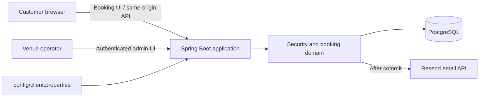

# FootballXtreme

**A modern booking and operations platform for independent football venues.**

FootballXtreme is a portfolio-quality B2B product foundation for venues that need a clean customer booking journey and dependable day-to-day pitch operations. It pairs a responsive, Bulgarian-language browser experience with a Spring Boot backend that protects the rules a venue actually depends on: availability, opening hours, blocked time and reservation integrity.

> **Current product boundary:** FootballXtreme is intentionally built as a single-facility deployment. It is a strong pilot and portfolio product, rather than a finished multi-tenant SaaS or payments platform.

## Why venues would use it

Small sports facilities often manage bookings through phone calls, messages and spreadsheets. That creates double bookings, inconsistent operating rules and unnecessary work for staff. FootballXtreme gives an operator one place to:

- publish available pitches and let customers request a time online;
- manage pitches, bookings and maintenance blocks from an authenticated admin area;
- enforce opening hours and prevent overlapping reservations at the server, not just in the browser;
- send booking and cancellation emails through Resend; and
- present a credible, branded digital booking experience.

## Product capabilities

| Area | What is available today |
| --- | --- |
| Customer booking | Browse active pitches, select a future date and half-hour start time, choose a 60- or 90-minute duration, and submit contact details. |
| Venue operations | Create, rename, activate or deactivate pitches; browse reservations; search by phone; cancel a reservation; and block a pitch for maintenance or private use. |
| Scheduling rules | Per-day opening hours, closed days, pitch-specific blocks, future-only bookings, supported durations and collision detection. |
| Booking integrity | Pitch-level database locking protects against concurrent double bookings and prevents a block from being placed over a confirmed reservation. |
| Privacy and access | Public availability omits customer details and block reasons. Operator actions require an authenticated admin session; state-changing requests use CSRF protection. |
| Notifications | Confirmation and cancellation email delivery is triggered after a successful transaction commit through Resend. |
| Venue profile | Public venue name, contact information, language and currency can be supplied through external client configuration. |

## Architecture



The static customer and administration interfaces are served by the same Spring Boot application as the REST API. This keeps the browser/API boundary simple for a single-venue deployment while PostgreSQL remains the source of truth for bookings.

## Quick start with Docker Compose

### Prerequisites

- Docker Desktop or Docker Engine with Docker Compose v2
- A Resend API key and verified sender address only when demonstrating real transactional email

1. Create a local environment file. It is ignored by Git.

   ```bash
   cp .env.example .env
   ```

   In PowerShell, use `Copy-Item .env.example .env`.

2. Edit `.env`. Set strong, unique values for `DB_PASSWORD` and `ADMIN_PASSWORD`; the administrator password must be 16–72 UTF-8 bytes. Email is optional for the visual demo; configure a real `RESEND_API_KEY` and verified sender before promising delivery to customers.

3. Start the application and its private PostgreSQL database.

   ```bash
   docker compose up --build
   ```

4. Open [http://localhost:8080](http://localhost:8080). The operator login is at [http://localhost:8080/admin-login.html](http://localhost:8080/admin-login.html).

5. The checked-in demo profile initializes three clearly labelled sample pitches and all working days when `DEMO_DATA_ENABLED=true`. Set it to `false` for a real venue, then create active pitches and configure working hours as described in [the deployment guide](docs/DEPLOYMENT.md#initial-operational-setup).

The Compose setup creates a named PostgreSQL volume and intentionally keeps the database off the host network. It derives the in-container database URL from the `db` service; `DB_URL` in `.env` is for a standalone local run, not for the Compose application container.

## Run without containers

For local backend development, install Java 25, Maven 3.9+ and PostgreSQL. Export the variables listed in [`.env.example`](.env.example) into the process environment, then run:

```bash
mvn spring-boot:run
```

Spring does **not** load `.env` files automatically. Use your shell, deployment platform or a deliberately managed external configuration source to provide those variables. Flyway applies the versioned schema on a new database; keep `DDL_AUTO=validate` for normal development and production.

## A concise demo script

1. Sign in as the venue operator and create two or more pitches.
2. Configure opening hours, then add a maintenance block for one pitch.
3. Open the public booking page in a separate browser session and select an available future slot.
4. Submit a booking and show the confirmation email from a verified Resend sender.
5. Return to the admin area to find the reservation, search by phone and cancel it.
6. Refresh public availability to show that customer data and private block reasons are never exposed.

For a portfolio presentation, capture the public booking page, the admin calendar/reservation view and a confirmation email after configuring a non-sensitive demo venue profile.

## Configuration reference

| Variable | Purpose |
| --- | --- |
| `DB_URL` | JDBC URL for a standalone Spring Boot process. Docker Compose supplies an internal URL automatically. |
| `DB_USERNAME`, `DB_PASSWORD` | PostgreSQL application credentials. Compose also uses them to initialize its database. |
| `ADMIN_USERNAME`, `ADMIN_PASSWORD` | In-memory administrator account; the password is BCrypt-hashed at startup. |
| `RESEND_API_KEY`, `RESEND_FROM_EMAIL` | Resend credentials and verified sender for transactional emails. |
| `COOKIE_SECURE` | Use `false` only for local HTTP. Set `true` behind production HTTPS. |
| `DDL_AUTO` | Keep `validate` for normal development and production; Flyway owns the versioned schema. |
| `DEMO_DATA_ENABLED` | Set `true` only on an empty demo database to seed three sample pitches and opening hours. |
| `APP_TIME_ZONE` | Optional Spring relaxed-binding override for the venue time zone; defaults to `Europe/Sofia`. |

Client-facing venue details live in `config/client.properties`. Start from [`config/client.properties.example`](config/client.properties.example); the real file is ignored by Git and must not contain secrets.

## Verification

Run the backend integration tests and browser-side availability tests with:

```bash
mvn verify
node --test src/test/js/availability.test.cjs
```

The Java test suite uses a disposable H2 database by default. Set `TEST_DB_URL`, `TEST_DB_USER` and `TEST_DB_PASSWORD` to run it against an empty disposable PostgreSQL database.

## Deployment and commercial readiness

Docker Compose makes the project easy to demonstrate or deploy as a single-host pilot. A paid production deployment still needs the operational work expected of a real B2B product: HTTPS termination, a secret manager, encrypted backups and restore drills, monitoring, delivery/retry handling for email, booking-abuse controls and a staging acceptance run.

See [docs/PRODUCT.md](docs/PRODUCT.md) for positioning and product scope, [docs/DEPLOYMENT.md](docs/DEPLOYMENT.md) for a deployment runbook, and [RELEASE_READINESS.md](RELEASE_READINESS.md) for the detailed release-risk baseline.

## Repository map

```text
src/main/java/          Spring Boot domain, API and security code
src/main/resources/     Application configuration and served browser UI
src/test/               Java integration and browser-side tests
config/                 Venue-specific external configuration
docker-compose.yml      Single-host app + PostgreSQL runtime
docs/                   Product positioning and deployment guidance
```

## Licence

This repository is **all rights reserved**. It is available for evaluation and portfolio review; copying, redistribution or commercial use requires prior written permission from the copyright holder. See [LICENSE](LICENSE).
